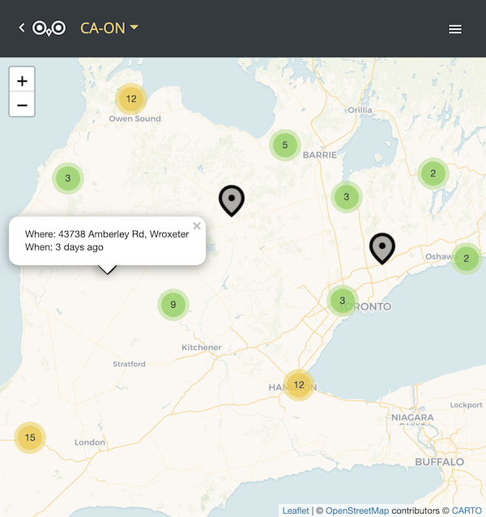

# [SnowyOwls.ca](https://www.snowyowls.ca)

- Production: https://www.snowyowls.ca

A web app to help people find Snowy Owls across Canada.



## Setup

```
npm install
```

## eBird Token

You need to request an [eBird API Token](https://ebird.org/api/keygen). Set the
value of your token in a local `.dev.vars` file for Wrangler:

```
API_KEY=your-token-here
```

## Development

To start a local development server:

```
npm run dev
```

Navigate to http://localhost:3000. Use `ctrl+c` twice to kill the two servers.

## Testing

To run linting and tests:

```
npm run lint
npm test
```

## Building

To build a production bundle in `out/`:

```
npm run build
```

## Deploying

Build the static site, then deploy the Worker and assets:

```
npm run deploy
```

Set the production eBird token as a Worker secret before the first deploy:

```
wrangler secret put API_KEY
```

## Notes

- Cloudflare serves the exported site from `out/` and the Worker handles `/recent`.
- Only `/recent*` runs through the Worker; static assets are served directly by Cloudflare.
- Analytics was removed during the Architect migration and is no longer posted from the client.
- if API routes are added, remember to also add development rewrites in [next.config.js](next.config.js)
- make sure the entire dev environment stays under ~500M. Use `npm run size` to check it.
